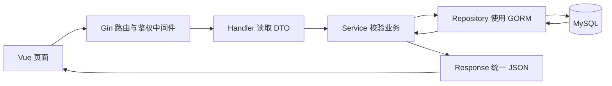

# Gin + GORM 后端分层

本项目参考 `aiagent_course/web` 的模块分层与手工依赖装配方式，并在 `bootstrap/` 中完成数据库环境准备，`migration/` 只保存假数据 SQL。

## 参考关系

| aiagent_course | 本课程 | 职责 |
|---|---|---|
| main.go | main.go | 启动、配置与服务生命周期 |
| config/ | config/ | 类型化配置和校验 |
| bootstrap/app.go | bootstrap/app.go | 手工创建并连接依赖 |
| bootstrap/database.go | bootstrap/database.go | GORM/MySQL 连接和连接池 |
| router/admin/ | router/admin/ | 管理接口注册 |
| middleware/ | middleware/ | 鉴权、异常恢复 |
| internal/course/admin/handler | internal/product/admin/handler | HTTP 参数与响应 |
| internal/course/admin/service | internal/product/admin/service | 业务校验与操作编排 |
| internal/course/admin/dto | internal/product/admin/dto | 请求和响应结构 |
| internal/course/repository | internal/product/repository | 数据访问及事务 |
| internal/course/entity | internal/product/entity | 数据库实体 |
| internal/dto/response | internal/dto/response | 统一响应输出 |
| internal/pkg/apperr | internal/pkg/apperr | 业务错误 |

依赖版本沿用参考项目的 Gin 1.12.0、GORM 1.31.1、GORM MySQL 驱动 1.6.0。

本课只包含一个后台，因此没有创建空的 front 模块；固定课堂账号使用 auth/handler、service、dto，暂不引入没有实际用途的用户仓储。

## 目录

```text
backend/
├── main.go
├── config/
│   ├── config.go
│   └── config_test.go
├── bootstrap/
│   ├── app.go
│   ├── database.go
│   ├── migrations.go
│   ├── task_migration.go
│   ├── migrations_test.go
│   └── README.md
├── migration/
│   ├── 001_products_seed.sql
│   └── 002_tasks_seed.sql
├── router/
│   ├── router.go
│   ├── router_test.go
│   └── admin/router.go
├── middleware/
│   ├── auth.go
│   └── error.go
└── internal/
    ├── task/                   # admin/{dto,handler,service}、repository、entity
    ├── product/
    │   ├── admin/
    │   │   ├── dto/product.go
    │   │   ├── handler/product.go
    │   │   └── service/product.go
    │   ├── repository/product_repository.go
    │   └── entity/product.go
    ├── auth/
    │   ├── dto/auth.go
    │   ├── handler/auth_handler.go
    │   └── service/auth_service.go
    ├── dto/response/response.go
    └── pkg/
        ├── apperr/apperr.go
        └── httpx/param.go
```

## 请求如何流转



以编辑商品为例：

1. `router/admin/router.go` 将 PUT /api/products/:id 注册到 Product.Update。
2. `middleware.Auth` 检查 Bearer token 是否有效，无效直接输出 401。
3. handler 使用 `httpx.ID` 读取 ID，用 `httpx.DecodeJSON` 读取 SaveRequest。
4. service 修剪字符串、校验分类、整数分价格、库存和状态，转换成 Product 实体。
5. repository 使用 GORM Updates 写入，显式包含零值和空字符串。
6. 唯一编码冲突转为业务 409，不存在转为 404，其他数据库错误输出通用 500。
7. handler 返回 `{code:0,data:null,message:"保存成功"}`，前端按当前条件刷新列表。

## 各层边界

- Handler 不写 SQL，不操作数据库对象，不保存业务状态。
- Service 不依赖 gin.Context，接收普通 context.Context 和 DTO。
- Repository 不依赖 Gin 和管理端 DTO，只接收查询参数与 entity。
- Entity 的时间字段使用 time.Time；Service 转为现有接口需要的 UTC+8 字符串。
- DTO 中状态用 *int 区分“没传”与合法的 0；数据库实体用 int。
- Bootstrap 负责连接、建库、建表与首次种子；业务实体和仓储仍归属各业务模块。
- Bootstrap 初始化数据库后装配依赖，不使用全局数据库变量，也不引入自动依赖注入工具。

## 保留的数据行为

- 继续使用既有 `lesson06_shop` 数据库和 products 表，迁移版本记录不变。
- 不使用 GORM AutoMigrate，不重建表、不清空商品、不重新插入已执行过的种子数据。
- 连接、建库、建表和种子初始化位于 bootstrap/，由 bootstrap.InitializeApp 显式按商品、任务的顺序执行。
- 假数据分别保存在 `migration/001_products_seed.sql`、`migration/002_tasks_seed.sql`，通过 `go:embed` 嵌入 Go 程序，在对应版本的初始化事务中执行，无需手动重复导入。
- 商品运行时的查询、更新、删除、批量事务全部进入 GORM repository。
- 查询总数与分页行使用同一可重复读事务；超出范围页码归到最后有效页。
- 批量上下架先锁定所有目标商品，缺少任一商品时回滚，不出现部分成功。
- Updates 使用 map，避免 GORM 默认跳过 status=0、stock=0 和 description=""。
- MySQL ClientFoundRows=true，未修改字段的保存也被视为成功。

## 与参考项目的有意差异

本次参考结构与依赖装配方式，保留本课已经联调好的协议：

- URL 继续为 `/api/products`，不改为 `/api/admin/v1/...`。
- 成功码为 0，字段名为 message，不采用参考项目的 code=200 / msg。
- pageSize、priceCents、updatedAt 等仍使用现有 camelCase。
- 错误继续使用对应 HTTP 状态码，不把所有业务错误都包装成 HTTP 200。
- 配置由 Go 自动读取当前工作目录的 .env，系统环境变量优先，不引入多环境 YAML、Redis、CAS、多租户和外部告警。
- 保留本地课堂账号与 8 小时内存会话，不在这次架构调整中改成另一套登录方案。

main.go 仍使用 net/http.Server 来承载 Gin Engine，目的是保留读写超时和优雅退出；具体路由、Context 和中间件均由 Gin 处理。

## 验证方式

```sh
# backend 目录
go test -race ./...
go vet ./...
go build ./...

# 项目根目录，新版 Go 服务启动后
python3 backend/tests/smoke.py
```

路由测试通过 httptest 调用真实 Gin Engine，检查鉴权、参数错误、JSON 大小限制、响应结构和退出失效。真实 API 脚本进一步验证 GORM 与本地 MySQL，包括零值更新、重复编码、批量原子性和末页回退。

数据库迁移和 GORM 仓储未用 mock 数据库代替验证，实际连接课程库执行回归；测试脚本只清理自己创建的 SMOKE-* 数据。

## 任务模块扩展

任务看板沿用同样的 `internal/task/admin/{dto,handler,service}`、`repository`、`entity` 分层。`bootstrap/app.go` 装配 Task handler，`router/admin/router.go` 注册已鉴权的 `/tasks` 路由。

`bootstrap/task_migration.go` 增量创建 tasks 和 task_board_meta，使用 lesson_migrations 版本 2 控制种子数据；不改写版本 1 的商品数据。任务仓储集中事务锁定看板版本行，防止排序与增删改相互覆盖；详细协议见 `07-任务接口与验收.md`。

## 数据库迁移与分享

`bootstrap/README.md` 说明各文件职责、新机器初始化、重复启动行为和后续迁移扩展。数据库账号和密码通过每台机器自己的 `.env` 配置，不随项目分享。迁移版本仍为 1、2，移动目录不会要求清库或重新导入数据。

可按该说明开启 `RUN_MYSQL_MIGRATION_TEST=1` 运行真实数据库测试：创建独立临时库，从应用装配入口完成初始化，修改和删除种子后重复执行，检查已有值、删除结果和看板版本保持不变；测试结束清理临时库。
