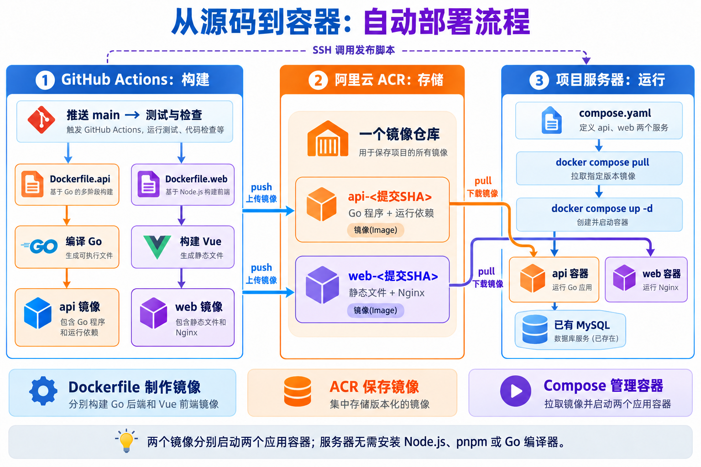

# 完成版线上部署与自动发布

> 文中的 `203.0.113.10` 仅为文档示例 IP，并非课程服务器地址；实际部署时请替换为自己的服务器公网 IP。

课程演示入口：https://test.retniw.cc 。登录账号 `admin`，密码 `123456`。线上发布的是 `frontend/apps/admin` 完整版；`apps/starter` 仍随源码提供，供本地实战使用。

源码仓库：[lesson-fullstack](https://github.com/kakozane/lesson-fullstack)。流水线：[GitHub Actions](https://github.com/kakozane/lesson-fullstack/actions)。

所有访问者共用同一个课堂账号和同一份演示数据，修改、拖拽、删除会影响其他访问者。仅使用演示数据；数据库独立于博客，容器重启和重新发布不会清空数据。服务重启后内存中的登录会话失效，需要重新登录。

## 从源码到运行服务：四者如何配合



图中的实线表示镜像传输及对应关系，虚线表示 SSH 部署控制。`pull` 只下载镜像，容器由后续 `up -d` 创建或更新；准确的标签格式见下方配置示例。

本项目将构建放在 GitHub Actions 上完成，将镜像保存到阿里云 ACR，再由服务器通过 Docker Compose 拉取并运行。构建过程和运行过程发生在不同机器上。

| 工具或配置 | 负责什么 | 本项目中的执行位置或使用方式 |
|---|---|---|
| GitHub Actions | 根据流水线安排检查、构建、推送和部署 | GitHub 提供的临时 Ubuntu 运行器 |
| Dockerfile | 定义如何安装构建依赖、编译源码、生成运行镜像 | Actions 调用 Docker Buildx 执行 |
| 阿里云 ACR | 存储和分发镜像，保留不同发布版本 | Actions 上传，服务器下载 |
| Docker Compose | 根据配置选择镜像，管理容器、端口、网络、环境变量和健康检查 | 项目服务器 |

```text
开发者推送 main
        │
        ▼
GitHub Actions 临时构建机器
  检出源码 → Go 测试与检查
        │
        ├─ Dockerfile.api → 编译 Go → api 镜像 ─┐
        └─ Dockerfile.web → 构建 Vue → web 镜像 ┤
                                               │ 推送镜像
                                               ▼
                                      阿里云 ACR 镜像仓库
                                               │ 拉取镜像
                                               ▼
项目服务器：Docker Compose
  compose.yaml → api 容器 + web 容器
                     │
                     └─ 连接已有 MySQL
```

Actions 在两个镜像推送成功后，通过 SSH 调用服务器的发布脚本；ACR 本身不负责通知服务器执行本项目的部署。

### 镜像、镜像仓库和容器的区别

- **镜像**：程序、运行依赖和启动配置组成的可分发产物。
- **镜像仓库**：存放镜像的地方，通过标签引用不同镜像或版本。
- **容器**：根据镜像创建的运行实例。同一个镜像可以创建多个容器。
- **Compose 配置**：描述一组服务如何运行。一份配置可以引用多个仓库中的多个镜像。

本项目每次发布生成两个应用镜像，运行两个应用容器。它们放在同一个 ACR 仓库，用标签区分：

```text
<ACR_REGISTRY>/<命名空间>/<仓库名>
├── api-<完整提交SHA>  → 后端镜像 → api 容器
└── web-<完整提交SHA>  → 前端镜像 → web 容器
```

因此，一个仓库不等于一个镜像，一个镜像也不包含两个容器。新版本发布后，仓库还可以保留旧提交对应的标签。也可以分别创建前后端仓库；本项目使用同仓库、不同标签的组织方式。

## Dockerfile：将源码制作成运行镜像

两个 Dockerfile 都使用多阶段构建：先在工具齐全的环境中构建，再把产物复制到独立的运行阶段。最终运行镜像无需包含前一阶段的完整工具链。

### 后端：Go 源码到可执行程序

对应文件：[deploy/Dockerfile.api](../deploy/Dockerfile.api)。

```dockerfile
FROM golang:1.26-alpine AS build
WORKDIR /src
COPY backend/go.mod backend/go.sum ./
RUN go mod download
COPY backend/ ./
RUN CGO_ENABLED=0 go build -trimpath -ldflags="-s -w" -o /server .

FROM alpine:3.23
RUN apk add --no-cache ca-certificates tzdata && adduser -D -u 10001 app
WORKDIR /app
USER app
COPY --from=build /server /app/server
EXPOSE 8080
CMD ["/app/server"]
```

第一段以 `golang:1.26-alpine` 为基础，将阶段命名为 `build`：

1. `WORKDIR /src` 设置后续指令的工作目录。
2. 先复制 `go.mod`、`go.sum` 并下载依赖。业务源码变化但依赖清单不变时，这部分通常可以复用缓存。
3. 复制后端源码，编译得到 `/server`。
4. `CGO_ENABLED=0` 关闭 CGO；`-trimpath` 移除构建路径信息；`-s -w` 去掉部分符号和调试信息，减小程序体积。

第二段以 `alpine:3.23` 重新开始，只安装 CA 证书、时区数据，并创建普通用户。`COPY --from=build` 从构建阶段取出可执行程序，`CMD` 指定容器默认启动命令。最终镜像不需要 Go 编译器和完整源码目录；本项目的 SQL 种子文件已由 Go 嵌入程序。

`RUN` 在构建镜像时执行；`CMD` 定义启动容器时默认执行什么。`EXPOSE 8080` 声明服务端口，不会自动开放宿主机端口。

### 前端：Vue 源码到静态文件

对应文件：[deploy/Dockerfile.web](../deploy/Dockerfile.web)。

```dockerfile
FROM node:24-alpine AS build
RUN corepack enable
WORKDIR /src
COPY frontend/ ./
# CI 使用官方源；本机开发仍可保留 .npmrc 的镜像源设置。
RUN corepack pnpm install --frozen-lockfile --registry=https://registry.npmjs.org
RUN corepack pnpm -F @vben/admin run typecheck && corepack pnpm build

FROM nginx:stable-alpine
COPY deploy/nginx.conf /etc/nginx/conf.d/default.conf
COPY --from=build /src/apps/admin/dist /usr/share/nginx/html
EXPOSE 80
```

构建阶段使用 Node.js 24，启用 Corepack，按项目约定的 pnpm 版本和锁文件安装依赖，再执行完成版类型检查与构建。复制整个 frontend workspace，是因为 admin 还依赖项目中的共享包。

最终阶段使用 Nginx 镜像，只复制 Nginx 配置和 `apps/admin/dist`。最终镜像包含 HTML、CSS、JS、图片等静态文件与 Nginx，无需携带 Node.js、pnpm 和构建阶段的 `node_modules`。这里沿用 Nginx 基础镜像的启动配置，没有另外声明 `CMD`。

浏览器下载并执行前端 JS；Nginx 提供静态文件，同时将 `/api/` 请求代理到 `http://api:8080`。其中 `api` 是 Compose 服务名，容器之间通过 Docker 网络通信。

项目根目录的 `.dockerignore` 排除了本地依赖、构建产物、后端 `.env` 和私钥等文件。构建使用项目根目录作为上下文，所以 Dockerfile 中的 `COPY backend/`、`COPY frontend/` 都相对于项目根目录。

## GitHub Actions：调用 Dockerfile 并推送镜像

对应文件：[.github/workflows/deploy.yaml](../.github/workflows/deploy.yaml)。`uses` 表示调用一个封装好的 Action，`run` 表示执行 Shell 命令。

### 触发、检查与任务依赖

```yaml
on:
  push:
    branches: [main]
  workflow_dispatch:
```

推送 main 或手动触发工作流后，先执行 `check`：检出源码、按 `backend/go.mod` 设置 Go 版本，并运行 `go test -race ./... && go vet ./...`。当前配置未按文件路径过滤，单独修改文档并推送 main 也会触发流水线。

```text
check 成功 → build(api) 与 build(web) 均成功 → deploy
```

构建任务通过 `needs: check` 等待检查通过，并用矩阵展开为两个任务：

```yaml
strategy:
  fail-fast: false
  matrix:
    service: [api, web]
```

两份任务可以并行执行，分别将 `matrix.service` 设置为 `api` 和 `web`。其中一个失败时，不立即取消另一个；只有两者均成功，`needs: build` 的部署任务才继续执行。

### 构建工具、认证与实际构建

每个构建任务先用 `actions/checkout` 取得源码，再用 `docker/setup-buildx-action` 准备构建工具，用 `docker/login-action` 登录 ACR。仓库域名从 GitHub Variables 读取，账号密码从 Secrets 读取。

真正调用 Dockerfile 的配置如下，摘自当前流水线：

```yaml
- uses: docker/build-push-action@v7.4.0
  with:
    context: .
    file: deploy/Dockerfile.${{ matrix.service }}
    platforms: linux/amd64
    push: true
    # ACR 个人版兼容普通镜像 manifest。
    provenance: false
    sbom: false
    tags: ${{ vars.ACR_IMAGE }}:${{ matrix.service }}-${{ github.sha }}
    cache-from: type=gha,scope=lesson-${{ matrix.service }}
    cache-to: type=gha,mode=max,scope=lesson-${{ matrix.service }}
```

| 字段 | 含义 |
|---|---|
| `context: .` | 使用仓库根目录作为构建上下文，并应用 `.dockerignore` |
| `file` | 根据矩阵选择 `Dockerfile.api` 或 `Dockerfile.web` |
| `platforms` | 为服务器构建 `linux/amd64` 镜像 |
| `push: true` | 构建完成后推送到 ACR |
| `tags` | 使用仓库地址、服务名和本次完整提交 SHA 组成镜像引用 |
| `cache-from` / `cache-to` | 读取和保存 GitHub Actions 构建缓存，api、web 分开缓存 |
| `provenance` / `sbom` | 当前为兼容 ACR 关闭附加证明与清单生成，不是应用代码开关 |

后端任务解析为 `deploy/Dockerfile.api` 和 `api-<SHA>`，前端任务解析为 `deploy/Dockerfile.web` 和 `web-<SHA>`。忽略缓存与附加选项，后端核心操作相当于：

```sh
# 示意命令：先替换仓库地址和提交 SHA
# 在项目根目录执行，末尾的 . 表示构建上下文
docker buildx build \
  -f deploy/Dockerfile.api \
  --platform linux/amd64 \
  -t '<ACR_REGISTRY>/<命名空间>/<仓库名>:api-<完整提交SHA>' \
  --push .
```

前端使用相同方式，将 Dockerfile 换为 `deploy/Dockerfile.web`，标签前缀换为 `web-`。这些操作由 Actions 执行，无需每次手动输入。

### ACR 保存什么

ACR 保存的是构建好的镜像，供服务器拉取。GitHub 运行器是临时环境，发布后不能依赖它保存应用的运行版本。镜像标签关联提交 SHA，便于定位代码版本和选择回滚版本。

镜像按层存储与传输，相同的层可以复用，因此更新不一定需要完整上传或下载一遍。拉取速度仍受带宽、镜像大小、缓存和访问链路影响；同为阿里云服务不代表自动使用内网地址。当前项目使用 ACR 公网访问配置。

## Docker Compose：选择镜像并运行容器

对应文件：[deploy/compose.yaml](../deploy/compose.yaml)。下面摘取选择镜像的部分：

```yaml
name: lesson-fullstack
services:
  api:
    image: ${ACR_IMAGE:?}:api-${IMAGE_TAG:?}
  web:
    image: ${ACR_IMAGE:?}:web-${IMAGE_TAG:?}
```

`ACR_IMAGE` 是不带标签的仓库完整地址；`IMAGE_TAG` 是发布提交的完整 SHA。`${变量:?}` 要求变量存在且非空，否则直接报错。

例如以下仅用于解释变量替换，`abc123` 是简写，实际发布脚本要求 40 位 SHA：

```dotenv
ACR_IMAGE=registry.example.com/demo/course
IMAGE_TAG=abc123
```

替换后的两个镜像引用为：

```text
registry.example.com/demo/course:api-abc123
registry.example.com/demo/course:web-abc123
```

`docker compose pull` 读取两个服务的 `image`，下载指定镜像；它不会下载仓库中的所有标签，也不会启动容器。`docker compose up -d` 再根据镜像及其余配置创建或更新容器。

| 当前 Compose 配置 | 作用 |
|---|---|
| `api.environment` | 向 Go 程序传入监听地址、数据库连接和登录密码 |
| `web.ports` | 将容器 80 端口映射到宿主机 `127.0.0.1:6330`，交给外层 Nginx 接入 |
| `web.depends_on` | 启动 Web 前等待 API 健康检查通过 |
| `healthcheck` | 请求健康接口，检查服务是否可用 |
| `restart: unless-stopped` | 配置自动重启策略，手动停止的容器除外 |
| `api.networks` | 同时接入应用网络和现有数据库网络 |
| `logging` | 限制单个日志文件大小和保留数量 |

这里使用 `image:` 引用成品镜像，没有 `build:`，所以服务器不会通过 Compose 编译源码。Compose 也支持调用 Dockerfile 构建，但本项目将这项工作放在 GitHub 上。

### 服务器实际执行的发布命令

Actions 将 Compose 配置和 `release.sh` 上传到服务器的对应版本目录，再通过 SSH 执行脚本。脚本的核心操作如下：

```sh
cd /opt/lesson-fullstack

# 由流水线传入本次发布的完整 40 位提交 SHA
export IMAGE_TAG='<完整提交SHA>'

docker compose --env-file .env \
  -f "releases/$IMAGE_TAG/compose.yaml" config --quiet

docker compose --env-file .env \
  -f "releases/$IMAGE_TAG/compose.yaml" pull

docker compose --env-file .env \
  -f "releases/$IMAGE_TAG/compose.yaml" \
  up -d --wait --wait-timeout 120
```

仓库地址和数据库连接来自服务器 `.env`。脚本通过环境变量设置本次 `IMAGE_TAG`，覆盖 `.env` 中保存的旧版本。`config --quiet` 验证配置且不打印展开后的密码；`pull` 拉取镜像；`up` 更新容器；`--wait` 等待服务健康，最长等待 120 秒。脚本还使用文件锁避免并发部署，并在健康检查成功后记录版本，详见后面的发布过程。

### 服务器还需要哪些资源

服务器不需要为这个项目安装 Go 编译器、Node.js 或 pnpm，但需要 Docker、Compose，以及当前部署使用的宿主机 Nginx、acme.sh 和已有 MySQL。构建阶段消耗 GitHub 运行器的 CPU、内存；服务器仍承担镜像下载解压、磁盘存储和容器运行消耗。

更新时，Compose 会替换镜像或配置发生变化的服务容器。服务器上的旧镜像和 ACR 中的旧标签不会因此自动删除，当前发布脚本也没有自动清理步骤。可按回滚需要保留成功版本，再分别清理服务器镜像与 ACR 标签。数据库在独立实例中，前后端容器替换不会删除数据库数据。

## 部署结构

```text
浏览器 https://test.retniw.cc
  → 宿主机 Nginx（HTTPS 证书）
  → 127.0.0.1:6330
  → Compose web（完整版静态页面 + /api 代理）
  → Compose api（Gin，容器内 8080）
  → 现有 MySQL 实例中的 lesson06_demo 数据库
```

服务器为 `203.0.113.10`，部署目录 `/opt/lesson-fullstack`。复用已有 `blog-backend` Docker 网络和 MySQL 实例，课程使用 `lesson06` 数据库账号，仅授权 `lesson06_demo.*`。不使用博客数据库或 Redis，不增加新的 MySQL 容器。

本机数据库配置不上传。服务器 `.env` 独立保存数据库连接和演示登录密码，权限为 `0600`。API 的端口不映射到宿主机，前端入口只绑定回环地址，由 Nginx 接收公网请求。

## 仓库中的部署文件

| 文件 | 用途 |
|---|---|
| `deploy/Dockerfile.api` | 编译 Go，运行镜像包含时区数据，使用非 root 用户 |
| `deploy/Dockerfile.web` | 安装锁定依赖、检查类型、只构建 `@vben/admin`，使用 Nginx 提供静态文件 |
| `deploy/nginx.conf` | 容器内 `/api` 代理和前端 history 路由回退 |
| `deploy/compose.yaml` | API、Web、健康检查、日志轮转和外部数据库网络 |
| `deploy/.env.example` | 服务器配置示例，不包含真实数据库密码 |
| `deploy/release.sh` | 拉取指定提交的镜像、更新容器、检查健康、记录成功版本 |
| `deploy/site.conf` | 宿主机域名与 HTTPS 配置 |
| `.github/workflows/deploy.yaml` | 检查代码、构建、推送 ACR、SSH 部署 |
| `.dockerignore` | 防止本机配置、依赖目录及编译产物进入构建上下文 |

Compose 使用 `service_healthy`，先等待 API 就绪，再启动 Web。[Docker 启动顺序说明](https://docs.docker.com/compose/how-tos/startup-order/)

## 镜像与 GitHub 配置

两个镜像共用同一个 ACR 仓库，以标签区分。以下均为占位符，使用时替换为自己账号中的仓库地址：

```text
<ACR_REGISTRY>/<命名空间>/<仓库名>:api-<完整提交SHA>
<ACR_REGISTRY>/<命名空间>/<仓库名>:web-<完整提交SHA>
```

GitHub 仓库 Settings → Secrets and variables → Actions 中配置：

| 类型 | 名称 | 内容 |
|---|---|---|
| Variable | `ACR_REGISTRY` | ACR 登录域名，不含协议和路径 |
| Variable | `ACR_IMAGE` | 上述 ACR 仓库完整路径，不含标签 |
| Variable | `DEPLOY_HOST` | `203.0.113.10` |
| Secret | `ACR_USERNAME` | ACR 登录账号 |
| Secret | `ACR_PASSWORD` | ACR 固定访问密码 |
| Secret | `SSH_PRIVATE_KEY` | 本项目专用部署私钥 |
| Secret | `SSH_KNOWN_HOSTS` | 已核验的服务器 SSH 主机公钥 |

部署用户是服务器 `root`，端口 22，与本次服务器环境一致；专用部署公钥配置了 `restrict`，禁止端口转发和交互终端，但允许流水线执行部署命令。服务端 Docker 也需登录 ACR，供 Compose 拉取私有镜像。

## 发布过程

推送 `main` 自动发布，也可在 Actions 页面手动运行 `Deploy course demo`：

1. Go 测试和静态检查。
2. 并行构建 API、Web 镜像；Web 构建包含完整应用类型检查。
3. 将两个镜像推送到 ACR，标签包含本次完整提交 SHA。
4. 上传 Compose 和发布脚本到 `/opt/lesson-fullstack/releases/<SHA>/`。
5. 执行发布脚本，拉取镜像，`docker compose up -d --wait` 等待健康。
6. 请求本机 `/api/health`，成功后记录 `current-release` 和 `.env` 中的 `IMAGE_TAG`。

同一时间只运行一条发布流水线，服务器发布脚本也使用文件锁。首次启动由 Go 自动创建表并导入 SQL 假数据；后续发布保留数据。服务器不编译 Node 或 Go 项目。

## HTTPS 与日常检查

证书原理、首次配置步骤、续期机制和故障排查见 [HTTPS 证书申请与自动续期](07-HTTPS证书申请与自动续期.md)。

宿主机配置位于 `/www/server/panel/vhost/nginx/test.retniw.cc.conf`，证书位于 `/www/server/panel/vhost/cert/test.retniw.cc/`。ACME HTTP 校验目录为 `/www/wwwroot/test.retniw.cc/.well-known/acme-challenge/`，80 端口保留该目录，其他请求跳转 HTTPS。

证书使用 acme.sh 管理，独立目录 `/opt/lesson-fullstack/acme`；续期任务位于 `/etc/cron.d/lesson-fullstack-cert`。续期成功后安装证书并检查、重载 Nginx。[acme.sh 官方说明](https://github.com/acmesh-official/acme.sh)

登录服务器后：

```sh
cd /opt/lesson-fullstack
docker compose ps
docker compose logs --tail=100 api web
curl -f http://127.0.0.1:6330/api/health
curl -f https://test.retniw.cc/api/health
cat current-release
```

生产数据库连接保存在服务器 `.env` 中；本地开发使用独立的 `backend/.env`。这些配置不随源码分享，也不写入应用镜像。

## 回滚

发布失败时流水线停止，不会自动回滚；先查看 Actions 与容器日志。已发布过的提交可以重新运行对应脚本：

```sh
# 将下方占位符替换成曾成功部署过的完整 40 位提交 SHA
previous_sha='<旧SHA>'
bash "/opt/lesson-fullstack/releases/$previous_sha/release.sh" "$previous_sha"
```

旧镜像需仍保留在 ACR。此操作只回滚应用镜像，不回滚数据库。当前项目的初始化仅建表和首次种子导入；将来若增加不兼容的数据库变更，应在发布前另行备份和规划迁移。
